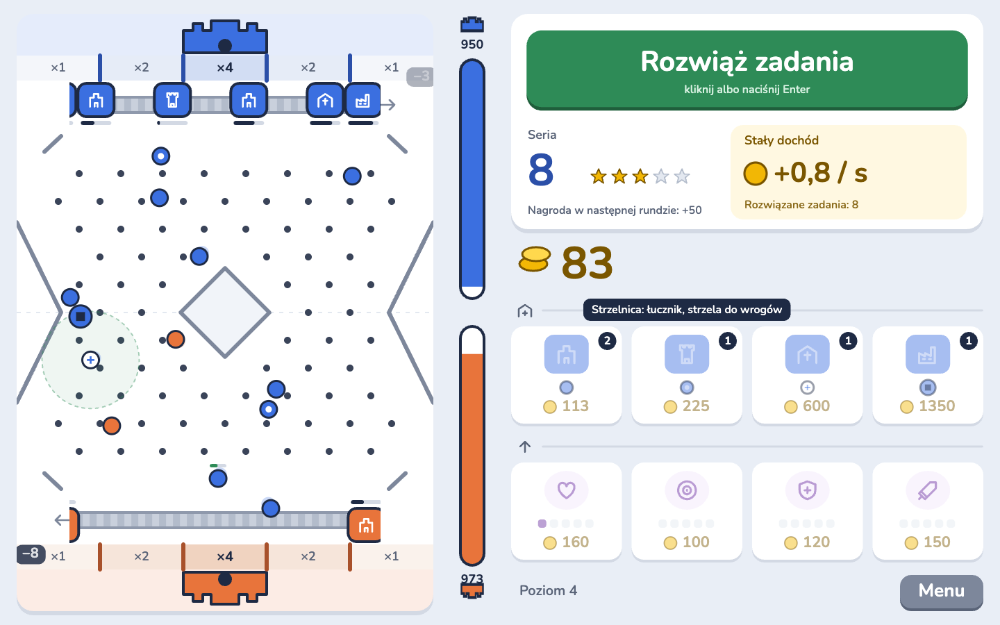
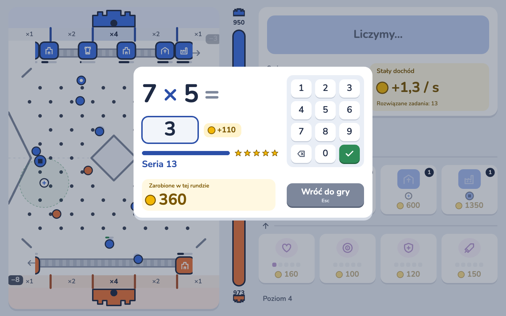
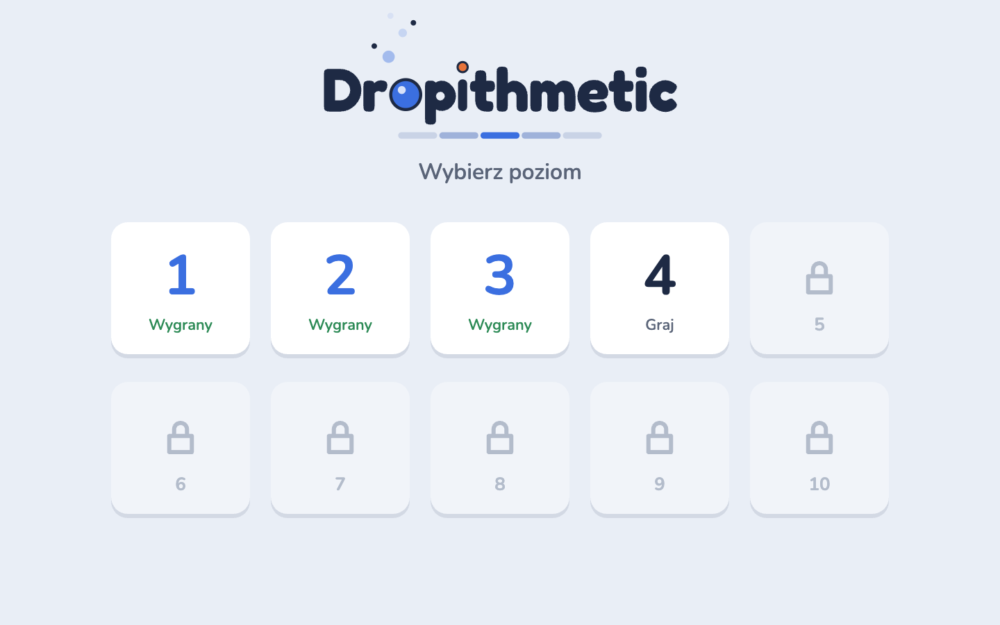

<p align="center">
  
</p>

<h3 align="center">Bitwa zamków, w której wygrywa ten, kto liczy.</h3>

<p align="center">
  <a href="https://vakrim.github.io/dropithmetic/"><b>▶ Zagraj teraz w przeglądarce</b></a><br>
  <sub>Bez instalacji i bez logowania. Działa na komputerze i na tablecie.</sub>
</p>

<p align="center">
  <a href="https://vakrim.github.io/dropithmetic/"></a>
</p>

## O co chodzi

Twój zamek stoi na górze planszy, zamek wroga na dole. Twoje jednostki spadają w dół, odbijają się od kołków i walczą z jednostkami przeciwnika. Każda, która doleci do wrogiego zamku, zabiera mu życie. Środkowe pole przy zamku liczy się podwójnie, a nawet poczwórnie.

Skąd wziąć złoto na nowe jednostki? Trzeba liczyć.

## Licz, żeby wygrać

<p align="center">
  
</p>

Kliknij **Rozwiąż zadania** albo naciśnij Enter. Bitwa staje, a Ty rozwiązujesz działania na czas.

- Każda dobra odpowiedź daje złoto.
- Im dłuższa seria, tym większa nagroda i trudniejsze zadania.
- Każde rozwiązane zadanie zwiększa też stały dochód do końca poziomu.
- Jeden błąd kończy rundę, więc warto się skupić.

Zadania rosną razem z serią: dodawanie i odejmowanie do 15, potem liczby dwucyfrowe i trzycyfrowe, przejście przez dziesiątkę, a na końcu tabliczka mnożenia i dzielenie.

## Buduj armię

Za zarobione złoto kupujesz budynki, a każdy z nich wysyła na planszę inne jednostki:

| Budynek    | Jednostka | Co robi                    |
| ---------- | --------- | -------------------------- |
| Koszary    | żołnierz  | mocno uderza               |
| Strzelnica | łucznik   | strzela do wrogów z daleka |
| Klasztor   | mnich     | leczy sojuszników          |
| Warsztat   | machina   | niszczy zamek              |

Ulepszenia dają żołnierzom i łucznikom więcej życia, łucznikom większy zasięg, mnichom silniejsze leczenie, a machinom większą siłę.

## 10 poziomów

<p align="center">
  
</p>

Każdy wygrany poziom otwiera następny. Wróg z każdym poziomem ma więcej złota i nowe jednostki. Postęp zapisuje się w przeglądarce.

**[Zagraj w Dropithmetic](https://vakrim.github.io/dropithmetic/)** i sprawdź, czy dojdziesz do dziesiątki.

## Sterowanie

| Klawisz       | Co robi                     |
| ------------- | --------------------------- |
| Enter, spacja | otwiera rundę zadań         |
| 0–9           | wpisuje odpowiedź           |
| Backspace     | kasuje cyfrę                |
| Enter         | zatwierdza odpowiedź        |
| Esc           | wraca do bitwy albo do menu |

Na tablecie wszystko działa dotykiem.

## Uruchomienie lokalne

```sh
pnpm install
pnpm dev
```
